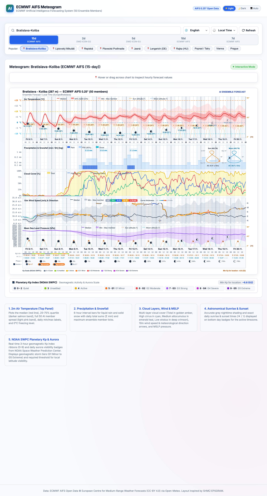

# ECMWF AIFS Meteogram Generator

An ensemble meteorological visualization platform modeled after Slovak Hydrometeorological Institute ([SHMÚ](https://www.shmu.sk/sk/?page=1&id=meteo_epsgramy)) EPSGRAM layouts. The system visualizes probabilistic forecasts using open data from the ECMWF **AIFS** (*Artificial Intelligence Forecasting System*, 50 ensemble members at 0.25° resolution) alongside regional numerical weather prediction ensembles from the Deutscher Wetterdienst (**DWD ICON-EU** and **DWD ICON-D2**).

Live Web Application: [https://igorcerovsky.github.io/AIFS-meteogram/](https://igorcerovsky.github.io/AIFS-meteogram/)



---

## Architecture Overview

The project consists of three components:

```
meteogram/
├── web/                           # Client-side web interface (HTML5 Canvas, CSS3, Vanilla JS)
│   ├── index.html                 # Single-page interface with geocoding search, presets, and model selector
│   ├── meteogram-chart.js         # Canvas rendering engine, interactive HUD, ephemeris, and direct API client
│   └── images/                    # Offline pre-rendered location caches
├── MeteogramApp/                  # Native Apple multiplatform client (SwiftUI)
│   ├── MeteogramApp.xcodeproj     # Xcode project for macOS 14.0+ and iOS/iPadOS 17.0+
│   ├── Sources/                   # SwiftUI views, models, viewmodels, and network services
│   ├── build_ipa.sh               # Standalone IPA packaging script for iOS sideloading
│   └── README.md                  # Native application build and deployment guide
└── server/                        # Python backend service and local proxy
    ├── server.py                  # HTTP server and REST endpoints (/api/forecast, /api/check_location)
    ├── aifs_client.py             # Open-Meteo ensemble API client, NOAA SWPC parser, and geocoder
    ├── com.meteogram.server.plist # macOS launchd service definition for background execution
    └── requirements.txt           # Python runtime dependencies
```

---

## Meteorological Models

| Model | Horizon | Resolution | Ensemble Members | Spatial Domain | Update Cycle |
| :--- | :--- | :--- | :--- | :--- | :--- |
| **ECMWF AIFS** | 15, 10, 7 days | 0.25° (~28 km) | 50 AI members | Global | 00z, 06z, 12z, 18z |
| **DWD ICON-EU** | 5 days (120 h) | 7.0 km | 40 members | Europe | 00z, 06z, 12z, 18z |
| **DWD ICON-D2** | 2 days (48 h) | 2.2 km | 20 members | Central Europe | 00z, 03z, 06z, 09z, 12z, 15z, 18z, 21z |

### Operational Fallback & Parameter Blending
- **Domain Validation**: Locations queried outside the DWD ICON-D2 Central European grid automatically fall back to DWD ICON-EU or ECMWF AIFS with a status notification.
- **Deterministic Parameter Backfill**: For regional ensemble runs omitting specific diagnostic levels, data pipelines automatically backfill missing parameters from corresponding high-resolution deterministic runs to maintain continuous time-series across all panels.
- **Hourly Continuity for ICON-EU**: Continuous boundary relaxation blends medium-range ensemble distributions into hourly profiles for consistent 5-day visualizations.

---

## Core Capabilities

### 1. Synchronized Multi-Panel Canvas Engine
- **High-DPI Canvas Rendering**: Dynamically scales with `window.devicePixelRatio` for standard and Retina displays.
- **Dual-Axis Timeline**: A top-anchored calendar axis displays weekday and date badges, allowing immediate temporal inspection without navigating to the bottom of the meteogram.
- **Adaptive Temporal Grid**:
  - Automatically switches major tick spacing: 3-hour ticks (`00, 03, 06, 09, 12, 15, 18, 21`) for 2-day short-range horizons, and 6-hour ticks (`00, 06, 12, 18`) for medium-range horizons (5d, 10d, 15d).
  - Synchronized vertical grid lines across all panels: solid midnight separators (`00:00`), dashed 6-hour reference lines, and dotted 3-hour intervals.
- **Interactive Inspection HUD**: Hover or touch movements display a floating glassmorphism readout with synchronized crosshairs, reporting exact temperature, precipitation, cloud fractions, barometric pressure, solar/lunar altitudes, and wind parameters at the selected timestamp.
- **Dynamic Wind Vector Indicator**: The inspection HUD renders an SVG wind direction arrow oriented to the true meteorological wind flow, color-coded across velocity thresholds (calm slate, teal, emerald, amber, and crimson).

### 2. Space Weather & Geomagnetic Activity (NOAA SWPC)
- **Planetary Kp Index Integration**: Ingests NOAA Space Weather Prediction Center (SWPC) 3-day geomagnetic forecasts at 3-hour resolution.
- **Geomagnetic Storm Scale (NOAA G-Scale)**: Maps 3-hour Kp values ($0-9$) to geomagnetic activity tiers: Quiet ($0-2$), Unsettled ($3$), Active ($4$), Minor storm G1 ($5$), Moderate G2 ($6$), Strong G3 ($7$), Severe G4 ($8$), and Extreme G5 ($9$).
- **Local Aurora Visibility Calculation**: Computes the minimum geomagnetic Kp threshold required for aurora borealis visibility based on the geographic latitude of the queried location.

### 3. Probabilistic & Astronomical Visualization
- **Precipitation 90th Percentile (P90) Envelope**: Semi-transparent 90th percentile bars render behind solid median precipitation bars, highlighting extreme rainfall and snowfall risks while preserving the median baseline.
- **Pseudo-Logarithmic Precipitation Scaling**: Employs logarithmic transformation ($v_0 = 0.2\text{ mm}$) to expand low-intensity precipitation ($0.1 - 2.0\text{ mm}$) for legibility of drizzle and light snow while accommodating heavy convective accumulation.
- **Continuous Directional Wind Loop**: Employs a continuous 5-point direction scale ($N \to W \to S \to E \to N$) to eliminate boundary wrap-around jumps for northerly and north-westerly wind directions.
- **Ephemeris Trajectories & Analemmas**:
  - Continuous solar and lunar altitude curves ($0^\circ - 90^\circ$) annotated with culmination times and peak angles.
  - Side-by-side Solar and Lunar analemma diagrams embedded in the precipitation panel, illustrating the Equation of Time ($+16\text{m}$ to $-14\text{m}$) and phase-accurate lunar illumination.
  - Daily astronomical cards displaying sunrise, sunset, moonrise, moonset, and vector-rendered moon phases with percentage illumination.

### 4. Client-Side Resilience & Offline Deployment
- **Zero-Backend Static Execution**: The web client includes a direct fetch engine that queries Open-Meteo's CORS-compliant API directly from the browser, allowing full operational deployment on static hosting platforms such as GitHub Pages.
- **Progressive Web App (PWA)**: Standalone PWA meta tags and manifest configurations permit installation directly to the iOS and Android home screens.
- **Cache Invalidation**: Dedicated refresh controls bypass both client and server caches (`refresh=1`, `Cache-Control: no-cache`) to ingest newly published model cycles (00z, 06z, 12z, 18z).

---

## Visualized Meteorological Parameters

1. **2m Air Temperature (°C)**:
   - Median ensemble curve, 25th–75th interquartile range (IQR) band, and minimum–maximum member envelope.
   - Temperature threshold lines: $-10^\circ\text{C}$ (blue), $0^\circ\text{C}$ (freezing level), $+10^\circ\text{C}$ (yellow), $+20^\circ\text{C}$ (orange), $+30^\circ\text{C}$ (red).
   - Solar and lunar altitude curves rising from and setting at the $0^\circ$ horizon, with culmination indicators (`☀ HH:MM (XX°)`, `☾ HH:MM (XX°)`).
2. **Precipitation & Snowfall (mm)**:
   - Median precipitation bars and 90th percentile (P90) ensemble probability bars.
   - Discrete snowfall fraction indicators, maximum ensemble member markers, and daily cumulative totals ($\Sigma\text{ mm}$).
   - Embedded Solar and Lunar analemma cards.
3. **Multi-Layer Cloud Cover (%)**:
   - Total cloud cover profile with basal histogram fills.
   - Separate curves for Low Stratus ($< 2\text{ km}$), Medium Altocumulus ($2 - 6\text{ km}$), and High Cirrus ($> 6\text{ km}$).
4. **10m Wind Speed & Direction**:
   - Continuous directional curve mapped to $N \to W \to S \to E \to N$.
   - Variable line thickness scaling with velocity ($< 2\text{ m/s}$ to $\ge 15\text{ m/s}$).
   - Velocity color categorization: $< 2\text{ m/s}$ (calm), $2-5\text{ m/s}$ (light), $5-10\text{ m/s}$ (moderate), $10-15\text{ m/s}$ (fresh/strong), $> 15\text{ m/s}$ (gale/storm).
5. **Mean Sea Level Pressure (MSLP, hPa)**:
   - Barometric pressure median curve and ensemble spread, referenced against the standard atmosphere line ($1013.25\text{ hPa}$).
   - Astronomical solar and lunar altitude curves with the secondary right-hand degree scale.
6. **Planetary Kp Index & Geomagnetic Activity (NOAA SWPC)**:
   - 3-hour geomagnetic Kp index bars colored by geomagnetic storm intensity.
   - Location-specific minimum threshold required for visual aurora observation.
7. **Day/Night & Astronomical Ephemeris**:
   - Twilight and night shading calculated from astronomical solar depression angles.
   - Daily calendar footers with sunrise, sunset, moonrise, moonset, and illuminated moon phase disks.

---

## Quick Start

### 1. Requirements

- Python 3.9+ (backend server)
- Modern web browser (Chrome, Firefox, Safari, Edge)

### 2. Installation

Clone the repository and install the Python dependencies:

```bash
git clone https://github.com/igorcerovsky/AIFS-meteogram.git
cd AIFS-meteogram
pip install -r server/requirements.txt
```

### 3. Running the Server

Start the local server (serves the web dashboard, forecast REST API, and native application backend):

```bash
python3 server/server.py 8080
```

Open `http://localhost:8080` in your web browser.

### 4. Background Service Configuration (macOS launchd)

To run the server continuously in the background on macOS:

```bash
cp server/com.meteogram.server.plist ~/Library/LaunchAgents/
launchctl load ~/Library/LaunchAgents/com.meteogram.server.plist
```

To stop or unload the service:

```bash
launchctl unload ~/Library/LaunchAgents/com.meteogram.server.plist
```

---

## REST API Reference

The backend exposes two primary endpoints:

### `GET /api/forecast`
Fetches structured meteorological time-series, statistical distributions, and ephemeris calculations.

- **Parameters**:
  - `location` *(string)*: City name, preset identifier, or coordinates (`latitude,longitude`).
  - `days` *(integer)*: Forecast duration (`2`, `5`, `7`, `10`, `15`).
  - `model` *(string)*: `aifs` (ECMWF AIFS), `icon_eu` (DWD ICON-EU), or `icon_d2` (DWD ICON-D2).
  - `lang` *(string)*: Language code (`en` or `sk`). Default: `en`.
  - `tz` *(string)*: Timezone mode (`local` or `utc`). Default: `local`.
  - `refresh` *(integer)*: Set to `1` to bypass disk cache.
- **Caching**: Local file-backed cache with 1-hour expiration. Requests with `refresh=1` or `Cache-Control: no-cache` bypass cache and query upstream providers immediately.

### `GET /api/check_location`
Validates coordinates, resolves elevation, and checks whether the coordinate falls within the high-resolution DWD ICON-D2 boundary.

- **Parameters**:
  - `location` *(string)*: Geographic name or coordinates (`lat,lon`).

---

## Native Apple Application (`MeteogramApp/`)

A native SwiftUI multiplatform client targeting macOS 14.0+ and iOS/iPadOS 17.0+.

### Capabilities
- **Native Chart Engine**: Swift Charts implementation mirroring web canvas rendering, including P90 precipitation bands, directional wind trajectories, and analemma cards.
- **Gesture Navigation**: Horizontal swiping between model horizons (`15d ↔ 2d ↔ 5d ↔ 10d ↔ 7d`) with locked time-domain boundaries to prevent viewport distortion.
- **Zoom & Pan Controls**: Pinch-to-zoom (up to 400%), clamped off-screen boundaries, double-tap zoom resets, and floating overlay controls.
- **Location Services**: CoreLocation integration for instant current-position forecasting.
- **Local Network Discovery**: Connects to the local server via `localhost:8080`, Bonjour hostname (`<hostname>.local:8080`), or manual IP configuration with real-time latency diagnostics.

### Build and Run
```bash
open MeteogramApp/MeteogramApp.xcodeproj
```
Select **My Mac** or an iOS device/simulator and run (`⌘R`).

For iOS sideloading via AltStore or SideStore without a paid Apple Developer account, compile a release package using the included packaging script:
```bash
./MeteogramApp/build_ipa.sh
```

Refer to [MeteogramApp/README.md](MeteogramApp/README.md) for full application documentation.

---

## Data Attribution & Licensing

- **ECMWF AIFS Open Data**: European Centre for Medium-Range Weather Forecasts ([CC-BY 4.0](https://creativecommons.org/licenses/by/4.0/)).
- **DWD Open Data**: Deutscher Wetterdienst open data program.
- **NOAA SWPC**: Planetary Kp Index and Space Weather alerts courtesy of the NOAA Space Weather Prediction Center.
- **API Distribution & Geocoding**: Data transport and open routing provided via [Open-Meteo](https://open-meteo.com).
- **Layout Reference**: Visual presentation and metric grouping inspired by [SHMÚ](https://www.shmu.sk) EPSGRAM layouts.
- **License**: Released under the [GNU General Public License v3](LICENSE).
